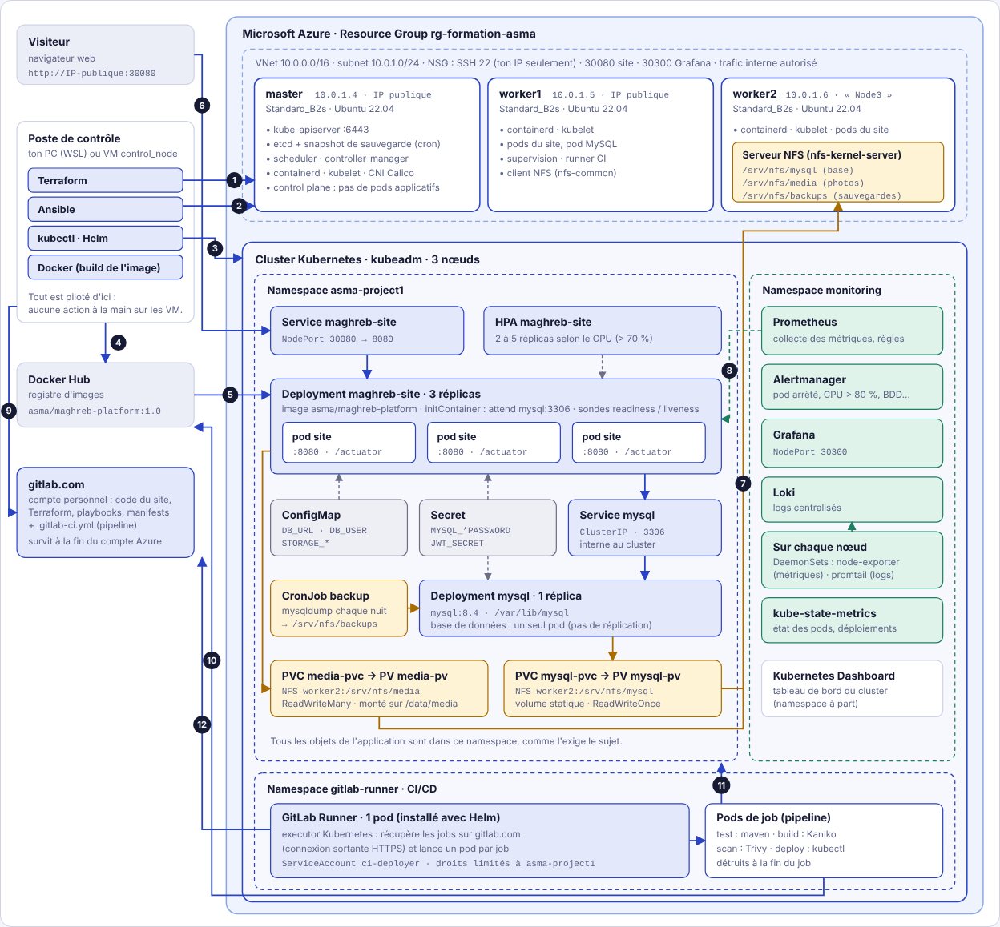

# Maghreb Platform — déploiement automatisé sur Kubernetes (Azure)

Mise en production automatisée d'une application e-commerce multi-tiers sur un cluster Kubernetes
de 3 nœuds, de l'infrastructure jusqu'à la supervision.

**Application** : Maghreb Platform, réseau social de boutiques d'Algérie, du Maroc et de Tunisie
(Spring Boot + MySQL). Les boutiques publient leurs produits ; les visiteurs les suivent, commentent
et envoient des demandes de commande.

**Stack** : Azure · Terraform · Ansible · Kubernetes (kubeadm) · NFS · Docker · GitLab CI/CD ·
Prometheus · Grafana · Loki




---

## Architecture

| Couche | Outil | Rôle |
|---|---|---|
| Infrastructure | Terraform | Réseau Azure (VNet, subnet, NSG) et 3 VM : master, worker1, worker2 |
| Configuration | Ansible | containerd, kubeadm, création du cluster, serveur NFS, déploiements |
| Orchestration | Kubernetes (kubeadm) | Namespace `asma-project1` : site (3 réplicas), MySQL, Services, ConfigMap, Secret, HPA |
| Stockage | NFS (worker2) | Volumes persistants statiques : données MySQL, photos des produits, sauvegardes |
| CI/CD | GitLab CI + runner dans le cluster | test → build (Kaniko) → scan (Trivy) → push → déploiement |
| Supervision | Prometheus, Grafana, Alertmanager | Métriques des nœuds, des pods et métriques métier de l'application |
| Logs | Loki, promtail | Logs centralisés de tous les pods |
| Sauvegarde | etcdctl, CronJob mysqldump | Snapshot du cluster et export quotidien de la base |

Schéma détaillé, flux réseau et objets Kubernetes : [`documentation/architecture.html`](documentation/architecture.html).

## Organisation du dépôt

```
terraform/       Infrastructure Azure
ansible/         Configuration des VM, cluster, déploiements
kubernetes/      Manifests du namespace de l'application
monitoring/      Prometheus, Grafana, alertes
logging/         Loki, promtail
documentation/   Architecture, rapport, captures
app/             L'application déployée (code source, tests, image)
  backend/         Spring Boot 3 / Java 21 : API + site (pages copiées dans le jar)
  frontend/public/ Pages du site (HTML, CSS, JavaScript)
  scripts/         Génération des données de démonstration
  design/          Maquette
.gitlab-ci.yml   Pipeline CI/CD
```

## Recréer tout l'environnement

> À compléter au fil des phases : la liste des commandes, dans l'ordre, pour tout reconstruire
> à partir de ce dépôt (Terraform → Ansible → application → supervision → CI/CD).

---

## L'application déployée

Un seul programme sert **le site et l'API** sur le port **8080**, avec une base **MySQL 8**.
Au démarrage, il crée lui-même ses tables (Flyway) et charge un jeu de démonstration
(boutiques fictives ; comptes `client@demo.example`, `dar-caftan@demo.example`… mot de passe `demo1234`).

### Configuration (variables d'environnement)

| Variable | Défaut | Rôle |
|---|---|---|
| `DB_URL` | `jdbc:mysql://localhost:3306/maghreb` | Connexion MySQL (dans le cluster : `jdbc:mysql://mysql:3306/maghreb`) |
| `DB_USER` / `DB_PASSWORD` | `maghreb` / `maghreb` | Identifiants de la base (**secret**) |
| `JWT_SECRET` | valeur de développement | Clé de signature des connexions, 32 caractères minimum (**secret**) |
| `STORAGE_TYPE` | `local` | `local` (dossier) ou `s3` (stockage objet) pour les photos |
| `STORAGE_LOCAL_DIR` | `./data/media` | Dossier des photos, à monter sur un volume persistant |

- **Santé** : `/actuator/health/liveness`, `/actuator/health/readiness`
- **Métriques** : `/actuator/prometheus` (HTTP, JVM et métriques métier `maghreb_*`)
- **Photos** : 5 Mo maximum par envoi
- **Sans état** : connexion par jeton JWT, aucune session serveur ; seules les photos sont à partager entre réplicas

### Lancer en local (Docker uniquement)

```powershell
docker run -d --name maghreb-mysql -p 3306:3306 -e MYSQL_DATABASE=maghreb -e MYSQL_USER=maghreb `
  -e MYSQL_PASSWORD=maghreb -e MYSQL_ROOT_PASSWORD=root mysql:8.4

docker run --rm -it -p 8080:8080 -v "${PWD}/app:/src" -v maghreb-m2:/root/.m2 -w /src/backend `
  -e DB_URL=jdbc:mysql://host.docker.internal:3306/maghreb maven:3.9-eclipse-temurin-21 mvn spring-boot:run
```

Puis http://localhost:8080. Tests : même commande avec `mvn verify` (base H2 en mémoire).

### API

| Méthode | Chemin | Accès | Rôle |
|---|---|---|---|
| POST | `/api/auth/register`, `/api/auth/login` | public | Créer un compte / se connecter |
| GET | `/api/feed?tab=all\|following&country=DZ&tag=…&q=…&page=0` | public | Fil d'actualité |
| GET | `/api/shops`, `/api/shops/{slug}`, `/api/shops/{slug}/posts` | public | Boutiques |
| PUT / DELETE | `/api/shops/{slug}/follow` | connecté | Suivre une boutique |
| POST | `/api/posts` | boutique | Publier un produit |
| PUT / DELETE | `/api/posts/{id}/like`, `/api/posts/{id}/save` | connecté | J'aime, enregistrer |
| POST | `/api/posts/{id}/comments`, `/api/posts/{id}/orders` | connecté | Commenter, demander une commande |
| POST / GET | `/api/media`, `/api/media/{key}` | connecté / public | Envoyer / afficher une photo |
| GET | `/api/me`, `/api/me/saved`, `/api/me/orders` | connecté | Profil, enregistrés, commandes |
| POST / PUT | `/api/me/shop` | connecté | Créer / modifier sa boutique |
| GET / PATCH | `/api/me/shop/orders`, `/api/me/shop/orders/{id}` | boutique | Demandes reçues, accepter / refuser |
